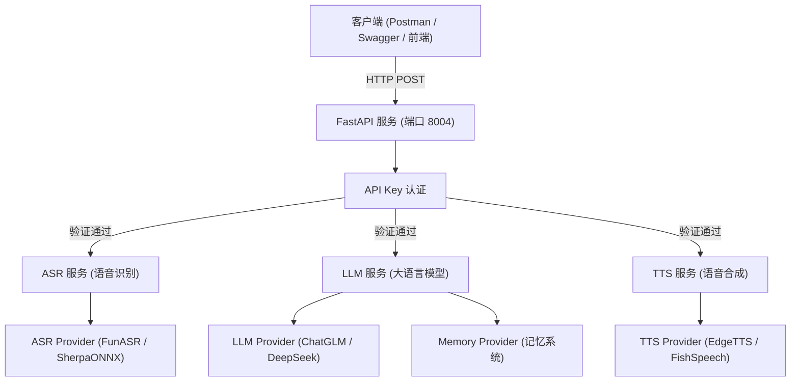

# 小智 AI FastAPI 服务

基于 FastAPI 重构的独立问答服务，提供 ASR（语音识别）、LLM（大语言模型）、TTS（语音合成）一体化 API，支持文本和语音输入输出，移除 ESP32 硬件依赖。

## 系统架构



## 目录结构

```text
xiaozhi-server/
├── api/                    # FastAPI 应用层
│   ├── app.py              # 应用入口、生命周期管理
│   ├── auth.py             # API Key 认证
│   ├── dependencies.py     # 服务容器（依赖注入）
│   ├── routes/
│   │   ├── ask.py          # /ask 智能问答接口（含无音源降级逻辑）
│   │   ├── asr.py          # /asr 独立语音识别接口
│   │   ├── tts.py          # /tts 独立语音合成接口
│   │   └── health.py       # /health 健康检查
│   └── schemas/
│       ├── request.py      # 请求模型
│       └── response.py     # 响应模型（AskResponse / ASRResponse / TTSResponse）
├── services/               # 业务逻辑层
│   ├── asr_service.py      # ASR 语音识别服务
│   ├── llm_service.py      # LLM 对话服务
│   └── tts_service.py      # TTS 语音合成服务
├── core/providers/         # Provider 实现层（复用原有代码）
│   ├── asr/                # ASR 提供者
│   ├── llm/                # LLM 提供者
│   └── tts/                # TTS 提供者
├── tests/
│   ├── conftest.py         # 测试配置（mock 注入、配置加载）
│   └── test_api_asr_tts.py # ASR/TTS/Ask 边界测试（13 个用例）
├── app_fastapi.py          # 启动脚本
└── config.yaml             # 配置文件
```

## 快速开始

### 环境要求

- Python 3.10+
- ffmpeg（`conda install -c conda-forge ffmpeg`）

### 安装依赖

```bash
conda create -n xiaozhi-server python=3.10
conda activate xiaozhi-server
pip install -r requirements.txt
pip install fastapi uvicorn[standard] python-multipart
```

### 启动服务

```bash
cd main/xiaozhi-server
python app_fastapi.py
```

### 启动成功示例

```text
╔═══════════════════════════════════════════════════════════════╗
║                    小智 AI FastAPI 服务                       ║
╠═══════════════════════════════════════════════════════════════╣
║  模式:  开发模式                                               ║
║  地址: http://0.0.0.0:8004                                     ║
║  文档: http://localhost:8004/docs                              ║
║  Workers: 1                                                   ║
╚═══════════════════════════════════════════════════════════════╝

INFO:     Uvicorn running on http://0.0.0.0:8004 (Press CTRL+C to quit)
INFO:     Waiting for application startup.
261008 18:23:52[...]-INFO-初始化组件: tts成功 EdgeTTS
261008 18:23:55[...]-INFO-初始化组件: llm成功 ChatGLMLLM
261008 18:24:34[...]-INFO-初始化组件: asr成功 FunASR
261008 18:24:34[...]-INFO-服务容器初始化完成
261008 18:24:34[...]-INFO-FastAPI 服务启动成功
261008 18:24:34[...]-INFO-API Key: xxxxxxxxxxxxxxxxx
```

### 访问文档

- Swagger UI: http://localhost:8004/docs
- ReDoc: http://localhost:8004/redoc

## 接口说明

### POST /api/v1/ask — 智能问答

| 输入类型 | 输出类型 | 说明 |
|---------|---------|------|
| text | text | 文本问答 |
| audio | text | 语音识别 + 问答 |
| text | audio | 问答 + 语音合成 |
| audio | audio | 语音识别 + 问答 + 语音合成 |

**参数：**

| 参数 | 类型 | 必填 | 说明 |
|------|------|:---:|------|
| input_type | string | 否 | 输入类型：`text`（默认）/ `audio` |
| output_type | string | 否 | 输出类型：`text`（默认）/ `audio` |
| text | string | 否 | 文本内容（text 模式必填；audio 模式下可选作兜底） |
| audio | file | 否 | 音频文件（audio 模式必填，支持 wav/mp3/pcm） |
| session_id | string | 否 | 会话 ID，维持上下文 |
| voice_id | string | 否 | 语音 ID，TTS 音色选择 |
| audio_format | string | 否 | 音频格式：`wav`（默认）/ `mp3` / `pcm` |

**无音源降级策略：**

当 `input_type=audio` 但未提供音频时，系统采用分层降级：
1. 检查 `text` 参数 → 有则自动降级为文本模式
2. 无 `text` 兜底 → 返回友好错误提示

### POST /api/v1/asr — 语音识别

接收音频文件，返回识别文本。

**参数：**

| 参数 | 类型 | 必填 | 说明 |
|------|------|:---:|------|
| audio | file | 是 | 音频文件（支持 wav/mp3/pcm） |
| audio_format | string | 否 | 音频格式：`wav`（默认）/ `mp3` / `pcm` |
| session_id | string | 否 | 会话 ID |

**响应示例：**

```json
{
    "status": "success",
    "text": "你好世界",
    "message": null
}
```

### POST /api/v1/tts — 语音合成

接收文本，返回语音文件。

**参数：**

| 参数 | 类型 | 必填 | 说明 |
|------|------|:---:|------|
| text | string | 是 | 要转换的文本 |
| audio_format | string | 否 | 输出格式：`wav`（默认）/ `mp3` |
| voice_id | string | 否 | 语音 ID |
| session_id | string | 否 | 会话 ID |

**响应：** 成功返回 `audio/wav` 或 `audio/mp3` 文件流，失败返回 JSON 错误信息。

### GET /health — 健康检查

**响应示例：**

```json
{
    "status": "ok",
    "service": "xiaozhi-ai-api"
}
```

## 认证方式

在请求头中添加：

```
Authorization: Bearer <api_key>
```

或在查询参数中传递：

```
?api_key=<api_key>
```

API Key 在服务启动日志中输出。

## 运行测试

```bash
conda activate xiaozhi-server
cd main/xiaozhi-server
python -m pytest tests/test_api_asr_tts.py -v
```

